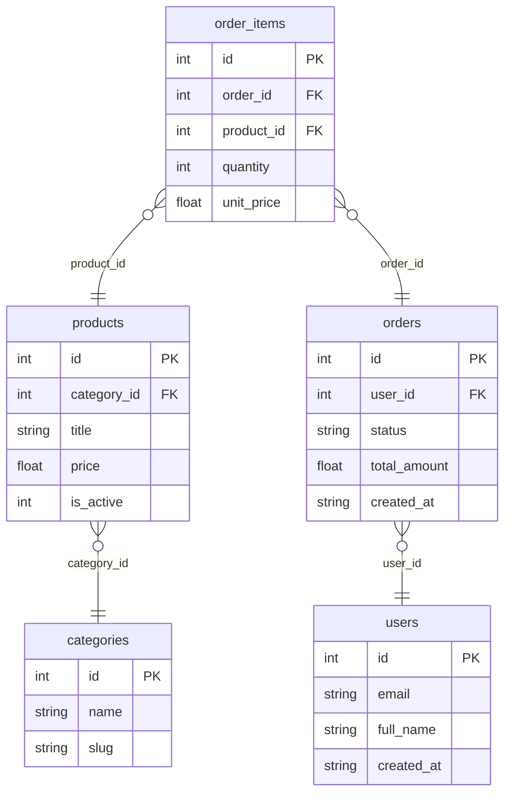

# schema2doc

**Zero-Dependency SQLite Schema to Markdown & Mermaid Documentation Generator**

[](https://www.python.org/downloads/release/python-3100/)
[](https://pypi.org/project/schema2doc/)
[](https://opensource.org/licenses/MIT)
[](#testing)

---

## Elevator Pitch

**schema2doc** — это open-source утилита для быстрой инспекции и документирования структуры баз данных.

Если вам нужно быстро «понять» базу: какие таблицы есть, какие типы полей, какие ключи и связи, какие индексы — ничего не нужно ставить тяжёлых инструментов (Java, Graphviz, внешние ORM) и ручками печатать документацию.

Просто передайте путь к SQLite-файлу — `schema2doc` сам выполнит introspection, соберёт метаданные и сгенерирует аккуратный `README.md` с таблицами и Mermaid ER-диаграммой.

---

## Quick Start

```bash
git clone https://github.com/your-org/schema2doc.git
cd schema2doc
python -m schema2doc examples/ecommerce.db -o SCHEMA.md
```

Или одной строчкой:

```bash
python -m schema2doc examples/ecommerce.db -o SCHEMA.md
```

После запуска вы получите готовый Markdown-файл с документацией.

---

## Features

- **Zero External Dependencies** — чистая стандартная библиотека Python (`sqlite3`, `dataclasses`, `argparse`). Никаких внешних пакетов и тяжёлых движков.
- **Automatic Mermaid ER Diagrams** — генерация интерактивной ER-диаграммы прямо внутри Markdown (`erDiagram`), рендерится на GitHub и в любом Mermaid-совместимом редакторе.
- **Full Schema Introspection** — типы данных, primary keys, foreign keys (с правилами `ON DELETE` / `ON UPDATE`), составные и уникальные индексы.
- **Zero Maintenance Metadata** — introspection через нативные PRAGMA-запросы SQLite, минимум кода и максимум возможностей.

---

## Live Demo

Ниже — реальная Mermaid ERD-диаграмма из сгенерированного примера `examples/ECOMMERCE_SCHEMA.md`. Она отрисовывается прямо в этом README (GitHub Mermaid) и в Markdown-редакторах, поддерживающих Mermaid.



---

## CLI Reference

| Аргумент | Описание | По умолчанию |
|---|---|---|
| `source` | Путь к SQLite-файлу базы данных (`.db` / `.sqlite`). | — |
| `-o`, `--output` | Путь к выходному Markdown-файлу. | `SCHEMA.md` |
| `--title` | Название базы данных для отчёта. | Имя файла-источника без расширения |

---

## Testing

```bash
python -m unittest discover -s tests -v
```

Результат: **12/12 тестов пройдены успешно** (0 внешних зависимостей — `unittest` из стандартной библиотеки).
