# E-Commerce DB
**Tables:** 5
**Columns:** 22
**Generated:** 2026-11-10

## Entity Relationship Diagram

```mermaid
erDiagram
    categories {
        int id PK
        string name
        string slug
    }
    order_items {
        int id PK
        int order_id FK
        int product_id FK
        int quantity
        float unit_price
    }
    orders {
        int id PK
        int user_id FK
        string status
        float total_amount
        string created_at
    }
    products {
        int id PK
        int category_id FK
        string title
        float price
        int is_active
    }
    users {
        int id PK
        string email
        string full_name
        string created_at
    }
order_items }o--|| products : "product_id"
order_items }o--|| orders : "order_id"
orders }o--|| users : "user_id"
products }o--|| categories : "category_id"
```

## Schema Details
### categories
**Rows:** 0

| Column | Type | Nullable | Default | Constraints |
| --- | --- | --- | --- | --- |
| id | int | NO |  | PRIMARY KEY |
| name | string | NO |  |  |
| slug | string | NO |  |  |

#### Indices
- sqlite_autoindex_categories_1 (UNIQUE) -- columns: slug

### order_items
**Rows:** 0

| Column | Type | Nullable | Default | Constraints |
| --- | --- | --- | --- | --- |
| id | int | NO |  | PRIMARY KEY |
| order_id | int | NO |  | FOREIGN KEY |
| product_id | int | NO |  | FOREIGN KEY |
| quantity | int | NO |  |  |
| unit_price | float | NO |  |  |

#### Foreign Keys
- product_id -> products(id) [ON DELETE CASCADE ON UPDATE RESTRICT]
- order_id -> orders(id) [ON DELETE CASCADE ON UPDATE RESTRICT]

### orders
**Rows:** 0

| Column | Type | Nullable | Default | Constraints |
| --- | --- | --- | --- | --- |
| id | int | NO |  | PRIMARY KEY |
| user_id | int | NO |  | FOREIGN KEY |
| status | string | NO |  |  |
| total_amount | float | NO |  |  |
| created_at | string | YES |  |  |

#### Foreign Keys
- user_id -> users(id) [ON DELETE CASCADE ON UPDATE RESTRICT]

### products
**Rows:** 0

| Column | Type | Nullable | Default | Constraints |
| --- | --- | --- | --- | --- |
| id | int | NO |  | PRIMARY KEY |
| category_id | int | NO |  | FOREIGN KEY |
| title | string | NO |  |  |
| price | float | NO |  |  |
| is_active | int | NO | 1 |  |

#### Foreign Keys
- category_id -> categories(id) [ON DELETE CASCADE ON UPDATE RESTRICT]

### users
**Rows:** 0

| Column | Type | Nullable | Default | Constraints |
| --- | --- | --- | --- | --- |
| id | int | NO |  | PRIMARY KEY |
| email | string | NO |  |  |
| full_name | string | NO |  |  |
| created_at | string | YES |  |  |

#### Indices
- sqlite_autoindex_users_1 (UNIQUE) -- columns: email
